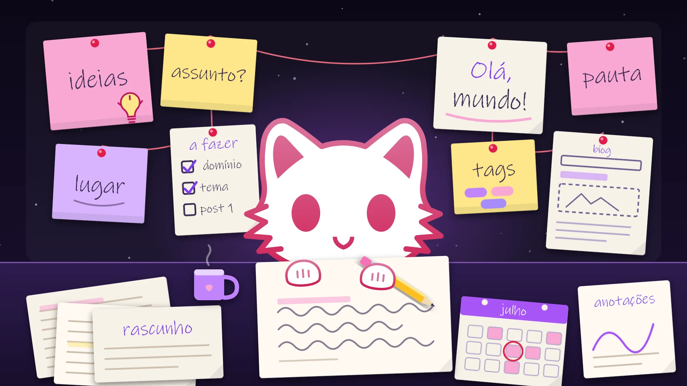
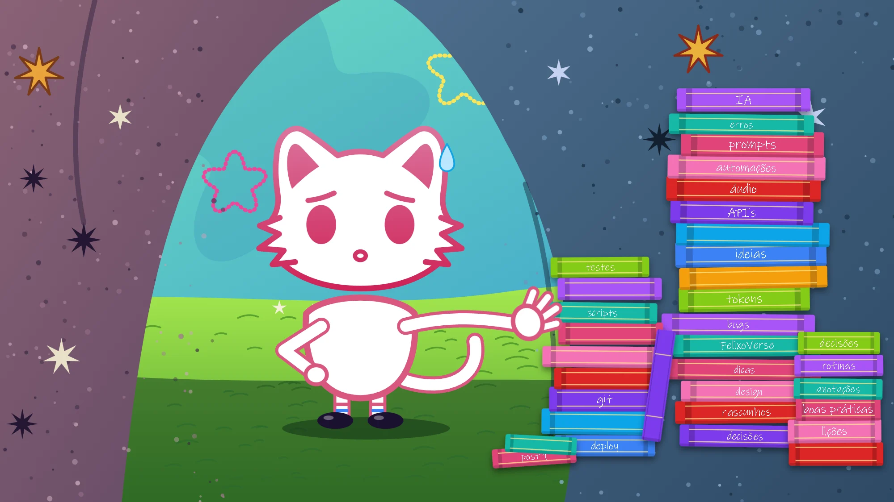
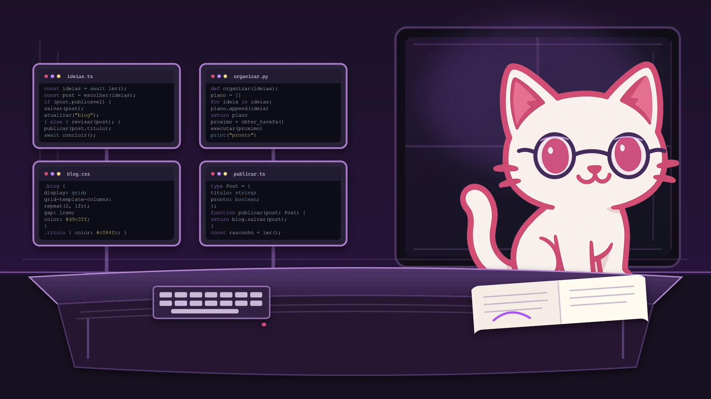

It really has been years since I started planning to create a blog to get my ideas in order. I never lacked the will, but I always lacked a subject I thought was worth writing about, and a place I'd like to look at every day. Both things changed this year.

## What changed

After a while studying and, mainly, **building things**, I started to accumulate decisions that I make over and over without ever having written down why. Every time I explained one of them to someone, I realized the explanation was already ready in my head. It just wasn't anywhere.

A blog is exactly that: the place where the explanation stops living only in my head.

## What you'll find here

- **Uncomplicated computing.** In a way that even your aunt will understand. Linking concepts in an interesting way for those who are just starting out.
- **Tested best practices.** I've always cared about being organized and meticulous, given my limits. In programming the care is redoubled and many things can go unnoticed, so I'll try to gather everything I've learned about best practices, from the beginning up to where I've got to.
- **Automations and tools.** A good part of my time goes into building things that do the boring work for me. Problems I created myself and solve myself, and that's what makes me grow. And I'll show how they work.
- **FelixoVerse.** My biggest personal project, a bit too ambitious, but with years of planning.

## A principle that guides almost everything here

If I had to sum up what I've learned in the last few years in a single sentence, it would be this:

> In the age of AI, always prefer a script to a manual change. Code is cheap, so use it to your advantage!

It seems small, but it changes the whole way of thinking. A manual change, besides being slower, solves today's problem and leaves no trace. A script solves the problem of today, of tomorrow, and the one six months from now, and, even better, it can be read, fixed and extended later, by you or by any tool you use to help you. With AI, your code repertoire says who you are! Code, tokens, time, all of this is money, and when you understand the importance of writing good, reusable code, you will be saving these 4 pillars.

In practice, this means that when I need to change a lot of data, or perform any manual action, my first instinct is not to open the interface and click: it's to write (or ask for) something like this.

  <input
    class="animacao-renomear-lote__estado"
    id="renomear-lote-en"
    type="checkbox"
  />
  

    

      
      
      
      Python
    

    

      <code class="animacao-renomear-lote__linha">
        def
        renomear_em_lote(itens:
        list[str], prefixo:
        str) -&gt;
        list[str]:
      </code>
      <code class="animacao-renomear-lote__linha animacao-renomear-lote__comentario">
        """Applies a prefix to each item, preserving the original order."""
      </code>
      <code class="animacao-renomear-lote__linha animacao-renomear-lote__retorno">
        return [f"{prefixo}{item}" for item in itens]
      </code>
    

  

  

    

      items
      
      result
      <label class="animacao-renomear-lote__executar" for="renomear-lote-en">
        ▶
        run
        ↻
        reset
      </label>
    

    

      relatorio.pdf
      →
      
        prefixo_relatorio.pdf
      
      
    

    

      notas.txt
      →
      
        prefixo_notas.txt
      
      
    

    

      fotos.zip
      →
      
        prefixo_fotos.zip
      
      
    

  

Thirty seconds more to write. Reusable forever, and very useful later.

## What now?

This is post number one, and it exists mainly so that number two has somewhere to show up. If you want to follow along, the [RSS feed](/rss.xml) is live.

Until next time.
